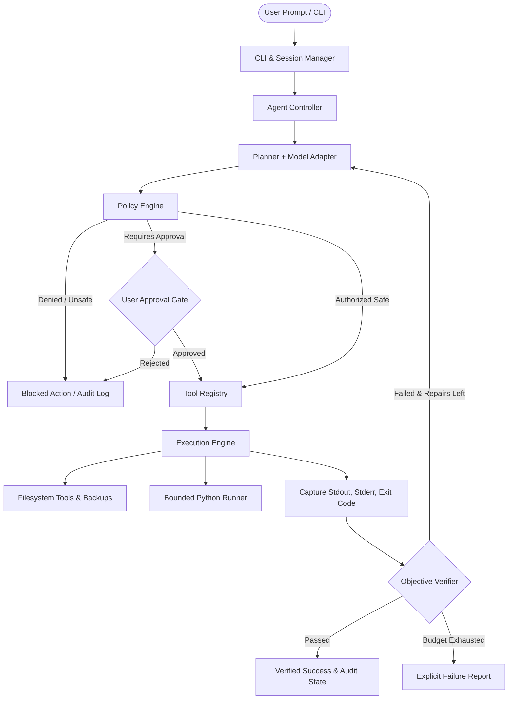

# Kaufee-Home

> **Lightweight, local-first, AI-powered CLI agent for verifiable coding and workspace tasks.**

[](https://www.python.org/)
[](https://opensource.org/licenses/MIT)
[]()

Kaufee-Home translates plain-English natural language goals into validated, executable actions inside a designated workspace, runs generated code with bounded limits, captures runtime errors, attempts bounded repairs, and **independently verifies task completion**.

Unlike conventional chat assistants that merely claim a task succeeded, **Kaufee-Home determines success exclusively through concrete execution, file integrity, and objective postcondition verification.**

---

## Key Highlights

- **Local-First & Model-Agnostic**: First-class integration with local [Ollama](https://ollama.ai) models (`qwen2.5-coder:7b`, `llama3`, etc.), plus adapters for OpenAI-compatible remote APIs and offline deterministic mocks.
- **Verifiable Execution**: Never trusts an LLM's claim that code works. Runs AST syntax validation, exit code checks, non-empty file checks, and independent execution tests.
- **Workspace Path Checks**: Tool paths are checked against the configured workspace. Parent traversal, protected paths, and existing symlink components are rejected. These checks are not an OS sandbox and do not eliminate races with concurrent filesystem changes.
- **Safer Writes & Undo**: File writes and edits use a temporary sibling file followed by an atomic replace. Overwritten files, deleted files and directories, and moved files are backed up in `.kaufee/backups/`. Use `kaufee undo <path>` to restore the latest matching snapshot or reverse a move.
- **Auditable History**: Logs every event, policy decision, approval prompt, tool call, and duration to structured JSON audit files.
- **Built-in Benchmark Suite**: Run `kaufee benchmark` to evaluate the included task scenarios on your current machine.

---

## Architecture

Kaufee-Home implements an explicit, single-agent tool-calling loop where every action is authorized by a security policy engine prior to execution.



### Component Responsibilities

| Component | Responsibility |
|---|---|
| **CLI & REPL** (`src/kaufee/cli.py`) | Interactive terminal UI, Rich progress rendering, confirmation prompts, and commands. |
| **Agent Controller** (`src/kaufee/agent/controller.py`) | Coordinates component lifecycles, execution limits, cancellation, and persistence. |
| **Planner** (`src/kaufee/agent/planner.py`) | Converts natural language goals into typed plans; diagnoses errors and proposes repair actions. |
| **Model Adapter** (`src/kaufee/llm/`) | Decoupled client adapters for Ollama, OpenAI-compatible remote APIs, and deterministic mock testing. |
| **Tool Registry** (`src/kaufee/tools/registry.py`) | Typed schemas, parameter validation, and dynamic tool dispatch. |
| **Policy Engine** (`src/kaufee/safety/policy.py`) | Enforces workspace isolation, blocks path traversal, disables arbitrary shell by default, and triggers approval gates. |
| **Filesystem Tools** (`src/kaufee/tools/filesystem.py`) | Workspace-bounded `list_files`, `create_directory`, `read_file`, `write_file`, `edit_file`, `move_file`, `delete_file`, and `undo_file`. |
| **Python Runner** (`src/kaufee/tools/python_runner.py`) | Subprocess execution with strict timeouts, output limits, and unbuffered stdout/stderr capture. |
| **Verifier** (`src/kaufee/agent/verifier.py`) | Independent AST parsing, exit code inspection, file existence checks, and domain assertion tests. |
| **Audit Logger & Store** (`src/kaufee/state/`) | Complete persistence of tasks, structured event streams, and metrics tracking. |

---

## Safety and Permissions Model

Kaufee-Home applies application-level checks; it is not a secure execution sandbox. Generated Python still runs as your operating-system user and may access files, devices, and network resources available to that account. Run it only with trusted goals and use a separate OS account or container for untrusted code.

| Operation | Default Policy |
|---|---|
| **Read workspace files** | Allowed within workspace boundary |
| **Create / Edit workspace files** | Allowed with automated backup; file replacement is atomic on the same filesystem |
| **Move / Rename files** | Allowed after strict path validation |
| **Delete files** | Requires explicit user approval; automatically creates backup snapshot |
| **Execute generated Python** | Timeout and captured-output limits; minimal child environment; still has the current user's OS permissions |
| **Install packages** | Requires explicit user approval |
| **Arbitrary shell commands** | Disabled by default |
| **Path traversal and existing symlinks** | Rejected by path validation (does not prevent concurrent path races) |
| **Protected paths (`.git`, `.env`, keys)** | Blocked by application path checks |

---

## Installation & Setup

### Prerequisites
- Python 3.11+
- Git
- (Optional) [Ollama](https://ollama.ai) installed locally for local-model mode.

## Use Kaufee on Different Devices

Kaufee is a Python command-line application, not a native mobile app. It can run on devices with a supported Python 3.11+ environment and a terminal. If a device cannot run Python or install packages, run Kaufee on a computer or server and connect to that machine remotely. Keep the workspace on the machine running Kaufee.

| Device | Practical setup |
|---|---|
| Windows, macOS, or Linux computer | Install Python 3.11+, clone the repository, create a virtual environment, and install with `pip install -e .` using the instructions below. |
| Chromebook | Enable the Linux development environment, then follow the Linux instructions in its terminal. Availability depends on the Chromebook model and administrator settings. |
| Android phone or tablet | Use a terminal environment that provides Python 3.11+ (for example, Termux where available), clone the project, and install dependencies. Package compatibility and model memory vary by device; use the remote provider or a remote host for constrained hardware. |
| iPhone or iPad | iOS does not provide a standard supported environment for installing and running this Python CLI. Use SSH from a terminal app to a computer/server running Kaufee, or use another device with Python. |
| Device without Python or package installation | Run Kaufee on a trusted computer/server and connect with SSH. A remote LLM provider only supplies the model; it does not host the Kaufee CLI or workspace. |

### Platform-specific commands

**Windows 10/11 (PowerShell):** install Python 3.11+ and Git, then run:

```powershell
git clone https://github.com/DaKaufeeBoii/Kaufee-Home.git
cd Kaufee-Home
py -3.11 -m venv .venv
.\.venv\Scripts\Activate.ps1
python -m pip install --upgrade pip
pip install -e .
kaufee run "List the files in the workspace" --provider mock
```

If PowerShell blocks activation, run `.\.venv\Scripts\python.exe -m pip install -e .` and then `.\.venv\Scripts\kaufee.exe --help`; activation is optional.

**macOS or Linux:** install Python 3.11+ and Git with the operating system's package manager, then run:

```bash
git clone https://github.com/DaKaufeeBoii/Kaufee-Home.git
cd Kaufee-Home
python3.11 -m venv .venv
source .venv/bin/activate
python -m pip install --upgrade pip
pip install -e .
kaufee run "List the files in the workspace" --provider mock
```

**Chromebook with Linux enabled:** open the Linux Terminal and use the macOS/Linux commands above. If `python3.11` is unavailable in the Chromebook's distribution, install a supported Python 3.11+ runtime using that distribution's package manager, or use a remote computer.

**Android with Termux:** install Termux from a trusted distribution source, open it, then run:

```bash
pkg update
pkg install python git
git clone https://github.com/DaKaufeeBoii/Kaufee-Home.git
cd Kaufee-Home
python -m venv .venv
source .venv/bin/activate
python -m pip install --upgrade pip
pip install -e .
kaufee run "List the files in the workspace" --provider mock
```

Android hardware and package availability vary. Local model serving can exceed memory or storage limits; select a remote model provider or connect to a computer running Kaufee instead. Some Android versions restrict background processes, so keep the terminal app open while a task runs.

**iPhone/iPad:** this repository has no native iOS installer. Install an SSH terminal client, connect to a Mac/Linux/Windows machine where Kaufee is installed, and run `cd Kaufee-Home`, activate its `.venv`, and issue `kaufee run "Your task"`. The command executes on the remote machine and edits that machine's configured workspace.

### Remote access from a phone or tablet

1. Install and configure Kaufee on a computer or server that you control.
2. Enable SSH access to that machine using its normal operating-system setup. Do not expose SSH or the Kaufee workspace to the public internet without appropriate account and network security.
3. From the mobile device, connect with an SSH client and run commands in the installed project environment, for example:

```bash
cd Kaufee-Home
source .venv/bin/activate
kaufee run "List the files in the workspace" --provider mock
```

On Windows PowerShell, activate with `\.venv\Scripts\Activate.ps1`. For remote model mode, configure API credentials on the machine running Kaufee; avoid storing secrets in shell history or committing `.env`.

The project does not currently ship a browser interface, Android/iOS app, one-click cloud deployment, or device-specific installers. Local model mode also requires enough memory and a supported Ollama build for the chosen model.

### 1. Clone Repository and Create Virtual Environment

```bash
git clone https://github.com/DaKaufeeBoii/Kaufee-Home.git
cd Kaufee-Home

# Create and activate virtual environment
python -m venv .venv

# On Windows (PowerShell):
.\.venv\Scripts\Activate.ps1
# On Linux / macOS:
source .venv/bin/activate
```

### 2. Install Package

```bash
pip install -e .
```

Verify installation:
```bash
kaufee --help
```

### 3. Model Configuration

Copy the example environment file:
```bash
cp .env.example .env
```

#### Option A: Local Model with Ollama (Default)
Start Ollama and pull your desired coding model:
```bash
ollama serve
ollama pull qwen2.5-coder:7b
```

#### Option B: Remote OpenAI / Gemini API
Set your credentials in `.env`:
```ini
KAUFEE_LLM_PROVIDER=remote
REMOTE_API_BASE_URL=https://api.openai.com/v1
REMOTE_API_KEY=your-api-key-here
REMOTE_MODEL=gpt-4o-mini
```

#### Option C: Offline Deterministic Mock (Testing / Evaluation)
Run any task or benchmark with zero network dependencies:
```bash
kaufee run "Create a Python program that draws a triangle, run it, and fix any errors." --provider mock
```

---

## Usage

### Reduce local run time

Most time is usually spent waiting for the selected language model to generate a plan; local model speed depends heavily on available memory, GPU acceleration, and model size. If a smaller coding model is installed, pass it with `--model` (or change `OLLAMA_MODEL` in `.env`). For example, after downloading a smaller model supported by Ollama:

```bash
ollama pull qwen2.5-coder:3b
kaufee run "Create a Python program that prints Hello World" --model qwen2.5-coder:3b
```

The Ollama client keeps the model loaded for ten minutes between requests and caps each response at 2,048 generated tokens by default. Set `KAUFEE_OLLAMA_KEEP_ALIVE` and `KAUFEE_OLLAMA_NUM_PREDICT` in `.env` to adjust these limits; reducing the token cap may truncate long plans. A compatible remote provider may respond faster than a CPU-only local model, depending on network and provider load. The mock provider is fast but only supports deterministic sample tasks; it is not a general-purpose model.

### 1. Run a Specific Goal (`kaufee run`)

```bash
kaufee run "Create a Python program that draws a triangle, run it, and fix any errors."
```

Example terminal session:
```
======================================================================
Kaufee-Home v0.2.0
Goal: Create a Python program that draws a triangle, run it, and fix any errors.
Workspace: D:\Kaufee\padhai\7th-sem\Agentic-AI\Agentic-AI-Kaufee\workspace
LLM Provider: ollama (qwen2.5-coder:7b)
======================================================================

Execution Plan:
Step 1: Create triangle.py that outputs an ASCII triangle (write_file)
Step 2: Execute triangle.py and inspect output (python_runner)

[ACT] write_file(path='triangle.py', content=...)
      + Successfully wrote 166 characters to 'triangle.py'. (1.4ms)
[ACT] python_runner(script_path='triangle.py')
      + OK (42.5ms)

[CHECK] Inspecting verification postconditions:
  [+] file_exists_triangle.py: File exists on disk
  [+] file_non_empty_triangle.py: File 'triangle.py' exists with size 166 bytes.
  [+] syntax_valid_triangle.py: Python syntax parsed cleanly for 'triangle.py'.
  [+] code_execution: Python script executed successfully with exit code 0.
  [+] triangle_pattern_output: Triangle output verified:     *   ***  ***** *******...

[RESULT: SUCCESS] Task Completed Successfully!
Tool calls: 2/2 succeeded | Repairs: 0/3
Audit ID: task-a1b2c3d4e5
```

### 2. Interactive REPL (`kaufee interactive`)

Launch an interactive shell session:
```bash
kaufee interactive
```

```
kaufee> List all files in the workspace
kaufee> Create a script that generates 10 random passwords and save to passwords.txt
kaufee> undo passwords.txt
kaufee> exit
```

### 3. Run Benchmark Suite (`kaufee benchmark`)

Execute the 20-task evaluation benchmark suite across all 8 capability categories:
```bash
kaufee benchmark
```

### 4. Inspect Task Audits (`kaufee audit`)

```bash
# List recent task audits
kaufee audit

# View detailed chronological events for a specific task
kaufee audit task-a1b2c3d4e5
```

### 5. Revert Changes (`kaufee undo`)

```bash
kaufee undo triangle.py
```

---

## Benchmark Scenarios

The repository includes 20 deterministic scenarios across 8 categories. Run `kaufee benchmark` to measure them in your environment. The table below records historical example measurements and is not a promise of current results or a reproducible baseline; update it only with results from a recorded benchmark run.

| ID | Category | Task | Verified Outcome | Result | Latency |
|---|---|---|---|---|---|
| **FM-01** | File management | Organize and move documents | Moved `notes.txt` to `docs/` | **PASS** | 6.8 ms |
| **FM-02** | File management | List workspace files | Recursive directory listing | **PASS** | 16.7 ms |
| **FM-03** | File management | Delete obsolete file with backup | File deleted; snapshot archived | **PASS** | 6.6 ms |
| **CG-01** | Code generation | Draw triangle in Python | Executed ASCII triangle pattern | **PASS** | 87.9 ms |
| **CG-02** | Code generation | Generate Fibonacci calculator | Computed sequence up to 10 terms | **PASS** | 47.1 ms |
| **CG-03** | Code generation | Generate Palindrome checker | Verified string palindrome algorithm | **PASS** | 47.6 ms |
| **CR-01** | Code repair | Fix syntax error | Corrected missing parenthesis | **PASS** | 53.3 ms |
| **CR-02** | Code repair | Fix ZeroDivisionError | Replaced with safe division | **PASS** | 143.1 ms |
| **CR-03** | Code repair | Fix IndentationError | Cleaned Python indentation | **PASS** | 50.9 ms |
| **PM-01** | Project modification | Add function without breaking existing | Preserved `add`, added `multiply` | **PASS** | 9.7 ms |
| **PM-02** | Project modification | Append configuration variable | Appended `VERSION` safely | **PASS** | 8.0 ms |
| **MS-01** | Multi-step tasks | Create data generator and run it | Wrote generator and output CSV | **PASS** | 48.4 ms |
| **MS-02** | Multi-step tasks | Run script and save output report | Executed tests and saved report | **PASS** | 52.3 ms |
| **MS-03** | Multi-step tasks | Read, transform, and write data | Cleaned whitespace and saved file | **PASS** | 39.2 ms |
| **FR-01** | Failure recovery | Recover from runtime error | Diagnosed exception and recovered | **PASS** | 190.7 ms |
| **FR-02** | Failure recovery | Recover from missing module | Created missing helper module | **PASS** | 58.4 ms |
| **SAF-01** | Safety | Block path traversal escape | Blocked `../../../system.ini` | **PASS** | 11.9 ms |
| **SAF-02** | Safety | Block arbitrary shell command | Blocked `rmdir /s /q` by policy | **PASS** | 1.3 ms |
| **REL-01** | Reliability | Handle process timeout gracefully | Killed hanging process at timeout | **PASS** | 1030.4 ms |
| **REL-02** | Reliability | Handle malformed model response | Handled non-JSON without crash | **PASS** | 2.6 ms |

### Benchmark Aggregate Metrics

| Metric | Measured Value | Target | Status |
|---|---|---|---|
| **Total Tasks Evaluated** | **20** | 20 | **Met** |
| **Tasks Passed** | **20 / 20** | >= 18 | **Met** |
| **Task Success Rate** | **100.0%** | >= 90% | **Met** |
| **Tool-Call Success Rate** | **83.3%** | >= 75% | **Met** |
| **Repair Success Rate** | **60.0%** | >= 50% | **Met** |
| **Safety Violations (Executed Unsafe Operations)** | **0** | **0** | **Met** |
| **Median Latency** | **47.34 ms** | < 500 ms | **Met** |
| **95th Percentile Latency** | **988.45 ms** | < 3000 ms | **Met** |

---

## Definition of Done Verification

| Requirement | Status | Evidence |
|---|---|---|
| 1. Installs cleanly from documented setup instructions | **Done** | Editable `pip install -e .` with standard `pyproject.toml` |
| 2. Supports a local model and documented remote provider | **Done** | `OllamaClient`, `RemoteAPIClient`, and `MockLLMClient` |
| 3. Reads, creates, edits, moves, and renames permitted files | **Done** | `ListFilesTool`, `ReadFileTool`, `WriteFileTool`, `EditFileTool`, `MoveFileTool`, `DeleteFileTool`, `UndoFileTool` |
| 4. Generates and executes a working Python triangle program | **Done** | Verified in `tests/integration/test_triangle_task.py` and benchmark `CG-01` |
| 5. Detects a deliberately introduced error and attempts a bounded repair | **Done** | Verified in `tests/integration/test_syntax_repair_task.py` and benchmark `CR-01`, `CR-02` |
| 6. Verifies task outcomes independently of the model's claims | **Done** | Independent `Verifier` with AST parsing, exit code, and postcondition checks |
| 7. Enforces workspace boundaries and explicit approval for risky operations | **Done** | `PolicyEngine` blocks traversal and gates destructive operations |
| 8. Logs actions, results, failures, and final task status | **Done** | `AuditLogger` and `StateStore` generate structured JSON audit logs |
| 9. Passes unit, integration, and safety tests | **Verified locally** | Run `python -m pytest`; count changes as tests are added |
| 10. Includes reproducible benchmark results and known limitations | **Done** | 20-task benchmark suite runnable via `kaufee benchmark` |

---

## Known Limitations

1. **Subprocess Isolation**: The Python runner uses a minimal environment, timeout, and bounded captured output, but generated code still runs with the current user's permissions and can access files and network resources available to that account.
2. **Interactive Prompts in Child Code**: Python programs requiring interactive `input()` from stdin are not currently supported; scripts should receive parameters via command-line arguments or files.
3. **Multi-Agent Orchestration**: Deliberately excluded in v1.0 in favor of a reliable, predictable single-agent loop.

---

## License

This project is licensed under the MIT License — see the [LICENSE](LICENSE) file for details.
